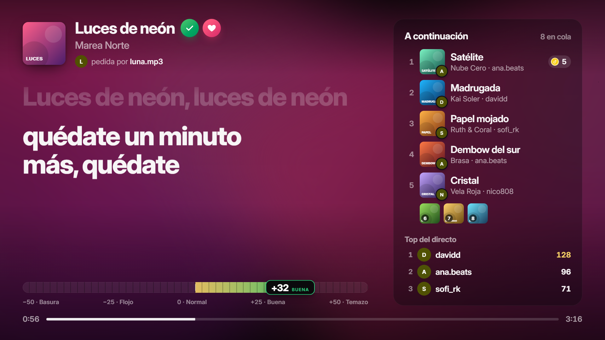
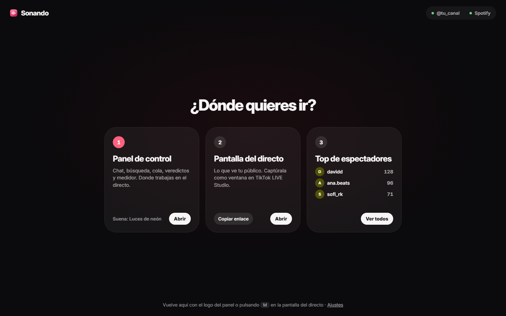
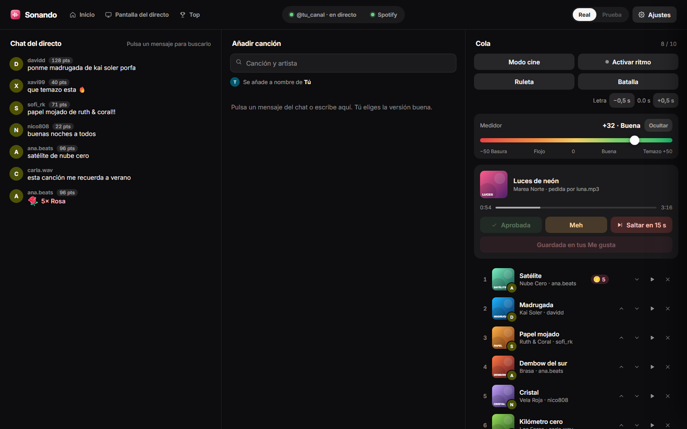
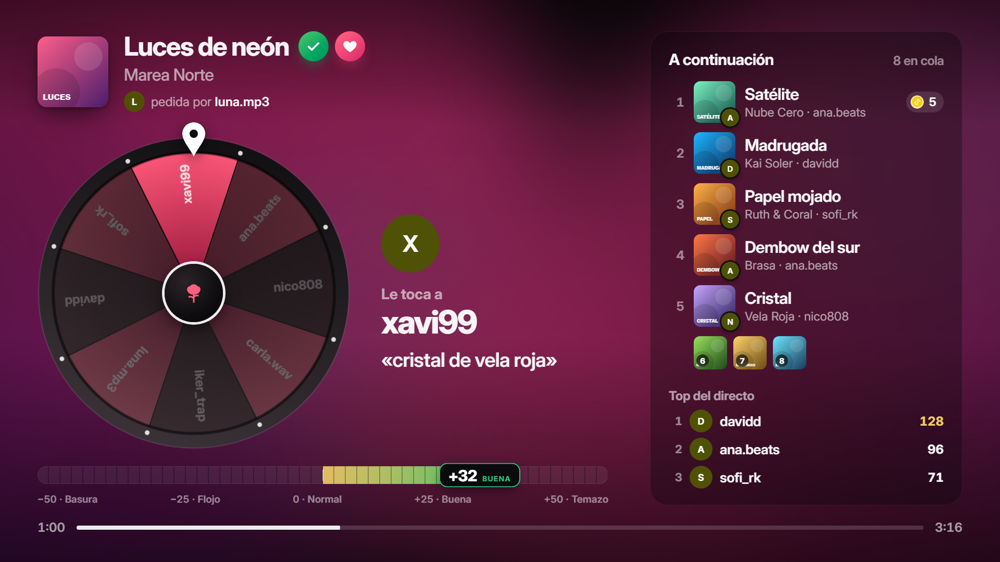
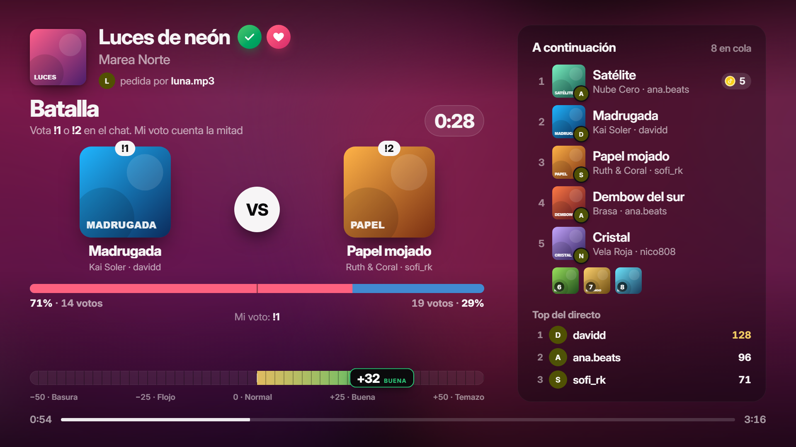
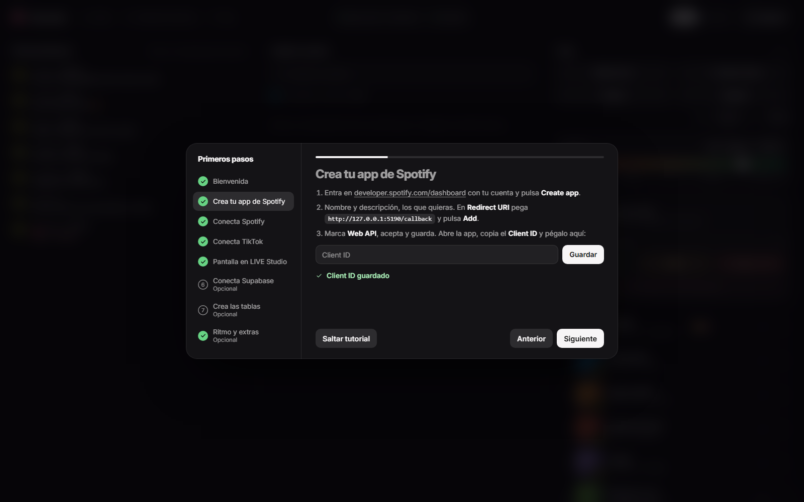
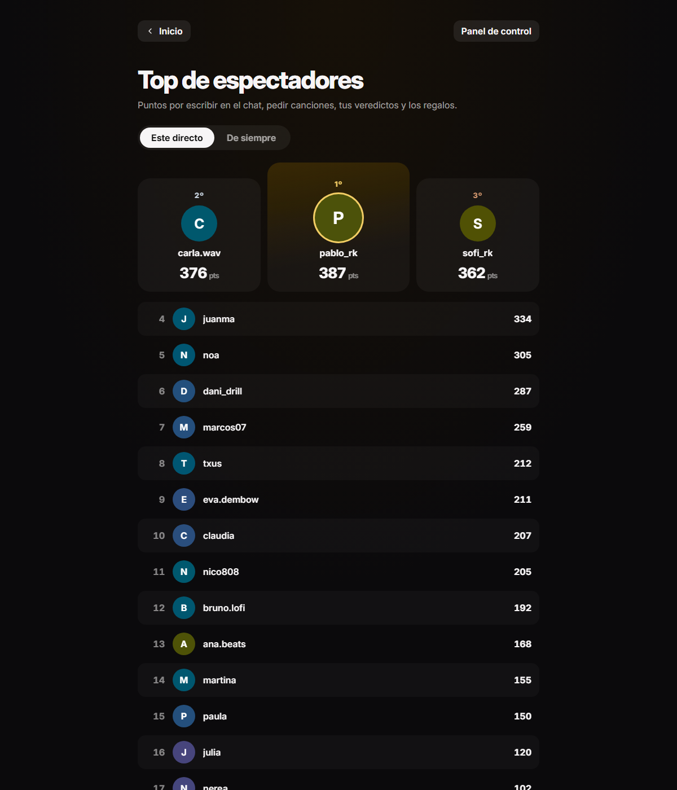

<p align="center"></p>

<h1 align="center">Sonando</h1>

**La cola de canciones para tus directos de TikTok.** Tu público pide canciones en el chat, tú eliges la versión buena en Spotify, y la pantalla del directo enseña la letra sincronizada, la cola, las donaciones, tu veredicto y un medidor de cuánto te está gustando.



> Todas las capturas usan datos de prueba: los nombres, canciones, letras y portadas son inventados.

## Qué hace

- **Chat de TikTok en el panel.** Pulsa un mensaje (o selecciona solo el nombre de la canción) y se busca en Spotify. Añades la versión correcta a nombre de quien la pidió.
- **Cola con reglas de donación.** Máximo 10 canciones; quien regala entra aunque esté llena. Un regalo de menos de 5 monedas sube su canción 2 puestos; 5 monedas la ponen la siguiente. Las donadas se escuchan enteras.
- **Letra sincronizada** al estilo de las apps de música, con la portada en grande cuando no hay letra.
- **Veredictos con animación:** Aprobada, Meh, Saltada (con cuenta atrás de 15 s para salvarla), Salvada y Guardada en tu lista.
- **Medidor de −50 a +50** (Basura · Flojo · Normal · Buena · Temazo) que mueves en directo. En +50 la pantalla se tiñe del color de la portada.
- **Puntos para tu público** por escribir, pedir canciones, tus veredictos y los regalos, con top del directo y top de siempre. Cada persona se reconoce por su ID de TikTok, aunque se cambie el nombre.
- **El fondo late con la música** (bombo y caja) y tiene modo cine.
- **Juegos en directo:** la **ruleta** (durante el tiempo que elijas, todo lo que escriban empezando por `!` entra en la rueda, y puedes quitar pedidos) y la **batalla de canciones** (el chat vota `!1` o `!2` y tu voto cuenta la mitad; la ganadora suena la siguiente).
- **Modo Prueba:** ensaya con chat y regalos de mentira sin tocar nada real. Al volver a Real, todo queda como estaba.
- **Alertas de donación** con la foto de quien regala y la del regalo.
- **Búsqueda de canciones, álbumes y EPs**, con «Añadir todas».

| Inicio | Panel de control |
| --- | --- |
|  |  |
| **Ruleta** | **Batalla de canciones** |
|  |  |
| **Tutorial de primera vez** | **Top de espectadores** |
|  |  |

## Descargar y empezar

1. En **[Releases](../../releases/latest)** descarga `Sonando.exe`. No hace falta instalar nada más.
2. Ábrelo. Se abre una ventana negra (déjala abierta mientras estés en directo) y la portada de Sonando en tu navegador.
3. El **tutorial** te guía paso a paso: crear tu app gratuita de Spotify, conectarla, conectar TikTok, añadir la pantalla en TikTok LIVE Studio y, si quieres, Supabase.

> Windows puede decir «Windows protegió su PC» porque el programa no está firmado digitalmente. Pulsa **Más información → Ejecutar de todas formas**. Si prefieres no fiarte del .exe, puedes construirlo tú desde el código (abajo).

**Con Spotify Premium** Sonando pone cada canción sola, salta y guarda en tus Me gusta. **Sin Premium** funciona en modo manual: te dice cuál toca, la abres en Spotify con un botón y la pantalla la detecta sola.

## Tus datos, privacidad y seguridad

- **Todo se guarda en tu PC**, en `%APPDATA%\Sonando` (en Ajustes → «Abrir carpeta de datos»): tu configuración, los tokens de Spotify, la cola y los puntos de tu público. No hay ningún servidor de Sonando: el programa habla directamente con Spotify, TikTok y LRCLIB (letras).
- **Solo escucha en tu propio PC** (`127.0.0.1`). Nadie de tu red ni de internet puede abrir tu panel. Por eso el panel no tiene contraseña: no lo expongas con túneles o reenvío de puertos.
- **Spotify:** se usa el inicio de sesión oficial (OAuth con PKCE) con la app que creas tú, así que Sonando nunca ve tu contraseña. Permisos que pide: ver y controlar lo que suena, y guardar canciones en tus Me gusta.
- **TikTok:** el chat y los regalos se leen con la librería no oficial [TikTok-Live-Connector](https://github.com/zerodytrash/TikTok-Live-Connector). Para conectar a un directo usa el servicio de firma de terceros [Euler Stream](https://www.eulerstream.com/), que recibe el nombre del directo al que te conectas. Sonando **no** usa tu sesión ni tu contraseña de TikTok. Si TikTok cambia algo, esta parte puede dejar de funcionar.
- **Supabase (opcional):** si lo conectas, se sube una copia de los puntos (ID de TikTok, nombre, @, foto y puntos). Con la clave *publishable* las tablas tienen que permitir escritura a quien tenga esa clave: no la compartas. Para más seguridad usa la clave secreta (`sb_secret_…`), que solo vive en tu PC, y quita las políticas del final de `supabase.sql`.
- **Fotos de perfil:** se piden a TikTok a través de tu propio Sonando para poder descartar las que llegan vacías.
- **Lo que ve tu público:** la pantalla del directo enseña nombres de TikTok, sus fotos y lo que donan. No enseña mensajes del chat.
- Encontraste un fallo de seguridad? Abre un *issue* sin detalles sensibles y contacta conmigo por TikTok.

## Construir desde el código

Necesitas [Node.js 24](https://nodejs.org/).

```bash
npm install
npm start          # arranca Sonando en http://127.0.0.1:5190
npm test           # pruebas de las reglas de la cola
npm run build      # crea dist/Sonando.exe (un solo archivo con Node dentro)
node build/shots.mjs   # rehace las capturas del README (con Sonando en marcha)
```

Cualquier página acepta `?demo` para verla con datos inventados, por ejemplo `http://127.0.0.1:5190/stage?demo`.

## Licencia

Sonando es software libre bajo la **[GNU AGPL-3.0](LICENSE)**. Puedes usarlo, estudiarlo, modificarlo y compartirlo. Si repartes una versión modificada (o la ofreces como servicio), tienes que publicar también su código bajo la misma licencia.

Incluye trabajo de terceros con sus propias licencias: ver [THIRD_PARTY_NOTICES.md](THIRD_PARTY_NOTICES.md).

Sonando no está afiliado ni respaldado por TikTok, ByteDance ni Spotify; sus nombres y marcas pertenecen a sus dueños. Úsalo respetando sus condiciones de uso. Se ofrece «tal cual», sin garantías.

---

Hecho por [@mitoficial_](https://www.tiktok.com/@mitoficial_).
